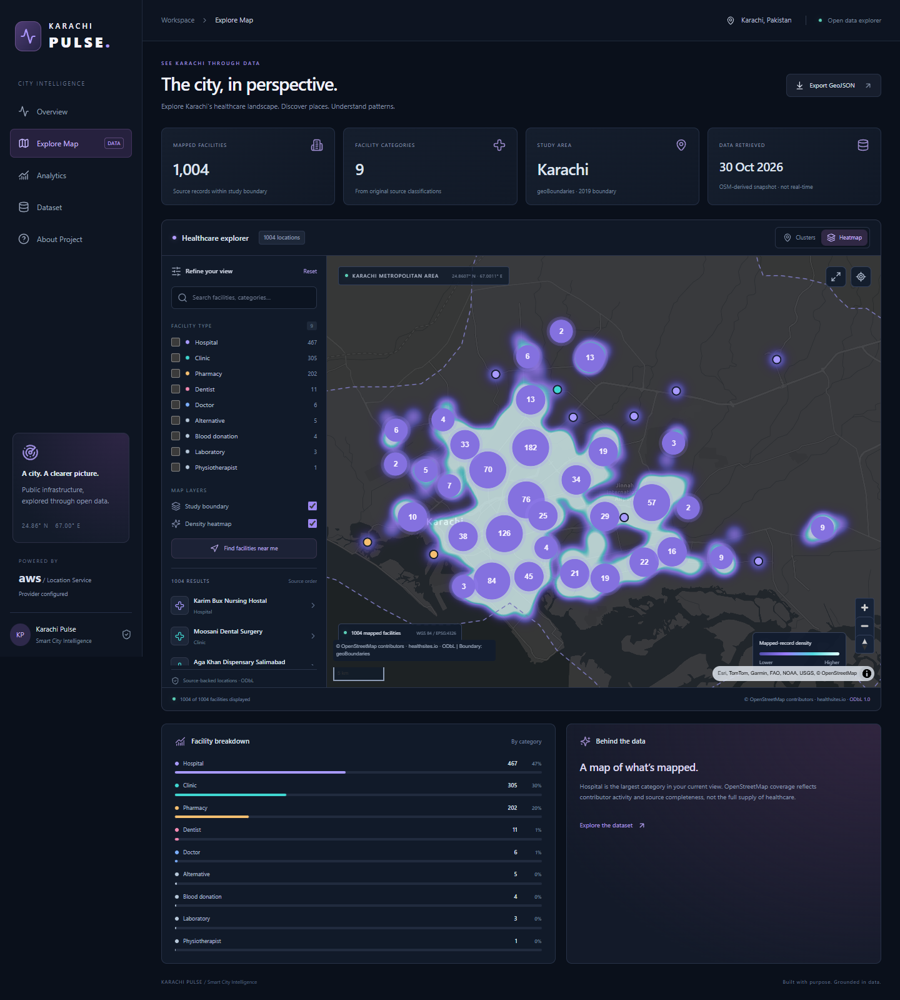

# Karachi Pulse

**See Karachi Through Data.** An interactive healthcare infrastructure explorer for Karachi, Pakistan.

Karachi’s facility data is scattered and unevenly documented. Pulse turns a real public registry into searchable, auditable geographical records without treating incomplete mapping as a complete account of healthcare provision.



## Status

**Live on AWS:** https://main.d1tsz0y1oa0yn.amplifyapp.com . Real Amazon Location styles and tiles were verified in desktop and mobile browsers. See [live deployment](docs/LIVE_DEPLOYMENT.md). The local revision contains additional validation fixes; publishing it requires AWS session renewal. Public GitHub publication and a public demo video remain pending.

## Features

- Search by facility name, category and available address; only actual source categories appear.
- Interactive MapLibre clusters, cluster expansion, zoom, pan, fit-to-data and study boundary overlay.
- Actual Amazon Location Service map-style URL when configured; explicit credential-free coordinate canvas otherwise. No substitute basemap provider.
- Genuine point-density heatmap and legend, responsive category analytics, facility metadata and source links.
- Nearby facilities and optional browser geolocation, using Turf straight-line distances.
- Filtered GeoJSON export, loading/error/retry/empty states, accessible controls, responsive desktop/mobile UI.
- Auditable Python ETL, per-row rejection ledger, hashed provenance and quality report.

## Real data

The [OpenDoc Pakistan registry](https://huggingface.co/datasets/opendoc-pakistan/pakistan_health_facility_registry) contains **2,997 nationwide rows**. Spatial filtering against geoBoundaries’ 2019 Karachi polygon accepts **1,004 facilities**: 467 hospitals, 305 clinics, 202 pharmacies, 11 dentists, 6 doctors, 5 alternative facilities, 4 blood donation facilities, 3 laboratories and 1 physiotherapist. These classifications come from source tags; operations are not independently verified.

**359 rows** lack valid coordinate pairs; **1,634** are outside the polygon. All 2,997 rows are accounted for. Five accepted facilities have no name and are explicitly labeled “Unnamed facility.” No duplicates were removed from this snapshot. See [dataset documentation](docs/DATASET.md) and [quality report](data-pipeline/data/processed/quality-report.json).

Facility data and derived databases: **ODbL 1.0**, © OpenStreetMap contributors / healthsites.io, via Open Data Pakistan and OpenDoc Pakistan. Boundary source metadata identifies Public Domain; attribute geoBoundaries under its distribution requirements. Original code: MIT. See [data attribution](DATA_LICENSE.md).

## Run locally

Requirements: Node 24+, npm, Python 3.12+ (Python only needed to regenerate data). Processed real data is included, so the UI starts without AWS or Python.

```powershell
cd D:\project\karachi-pulse\frontend
npm ci
Copy-Item .env.example .env.local
npm run dev
```

Open `http://127.0.0.1:5173`. Without a map API key the app shows an explicit no-basemap notice while retaining genuine overlays and all local analysis. To enable AWS rendering, configure `VITE_AWS_REGION`, `VITE_LOCATION_MAP_NAME`, and `VITE_LOCATION_API_KEY` as described in [AWS setup](infrastructure/aws-setup.md), then restart Vite. These are browser configuration values; never supply AWS secret access keys.

`VITE_DATA_URL` optionally points to a same-origin dataset endpoint or short-lived private-S3 presigned URL. An expired S3 URL produces a recoverable error, not a silent data substitution. Omit it to use the bundled ODbL snapshot. For sustained public hosting use the bundled snapshot refreshed at build time; do not embed expiring S3 URLs in permanent builds.

## Rebuild data

```powershell
cd D:\project\karachi-pulse
python -m venv .venv
.\.venv\Scripts\python -m pip install -r data-pipeline/requirements.txt
.\.venv\Scripts\python data-pipeline/scripts/export_geojson.py
```

The ETL downloads pinned source revisions into ignored `data/raw`, validates coordinates, uses Shapely point-in-polygon including boundary edges, normalizes categories, audits duplicates, exports GeoJSON/CSV and copies public assets into the frontend. Cached input hashes and retrieval times are retained; `--refresh` downloads the pinned inputs again. Both accepted and rejected counts and source missing-value counts are reported. Distinct facilities at identical coordinates are retained and flagged; exact name/geometry duplicates and duplicate IDs are rejected with reasons. See [architecture](docs/ARCHITECTURE.md).

This workspace also contains an ignored standalone Python runtime at `.tools/python/python.exe` because the system Python alias was unusable. It can run the same scripts directly; it is not part of the distributable repository.

## Tests and build

```powershell
cd frontend
npm test
npm run lint
npm run build
npm audit
npx playwright test
cd ..
python -m pytest data-pipeline/tests -q
```

Browser tests use installed Microsoft Edge at desktop and mobile viewport sizes; change the Playwright `channel` if using another installed Chromium. This is mobile emulation, not a physical-device test. The tests verify real bundled data, clusters, filters, details, heatmap, navigation and absence of horizontal overflow. Unit tests use clearly isolated test fixtures, never production records. See [verification report](docs/VERIFICATION.md).

## Structure

```text
frontend/                 React, TypeScript, Vite, Tailwind, Lucide, MapLibre, Turf
  src/map/                AWS style integration, WebGL layers and clusters
  src/services/           GeoJSON loading, validation, search and aggregates
  src/types/              GeoJSON/metadata types
  public/data/            Genuine processed snapshot and boundary
  tests/                  Component and service tests
  e2e/                    Desktop/mobile browser tests
data-pipeline/
  scripts/                Extract, transform, validate, export, S3 upload
  data/processed/         GeoJSON, CSV, rejection ledger, audit report
  tests/                  Spatial, coordinate and duplicate regression tests
infrastructure/           AWS setup instructions and CORS configuration
docs/                     Architecture, data, deployment, QA, submission, demo
research/                 Retrieved source README and boundary metadata
amplify.yml               Amplify monorepo build configuration
```

## Deployment and submission

Follow [deployment instructions](docs/DEPLOYMENT.md), [service status](docs/AWS_SERVICES.md), and [cost notes](docs/COSTS.md). [Submission draft](docs/SUBMISSION.md) and a [2:40 demo script](docs/DEMO_SCRIPT.md) are ready. The live AWS app and map rendering are verified. A public video under three minutes remains required; public code is encouraged and optional under the supplied brief. Current challenge terms were not verifiable from the accessible official pages; eligibility is not claimed.

## Limits and next improvements

The registry is historical and incomplete; retrieval date is not observation date. Nine categories represent source tags, not regulatory classifications. The study polygon represents 2019 geography, so current administrative district comparisons are intentionally unavailable. Address fields are almost entirely empty. A heatmap reveals mapped-record concentration, not population-adjusted access, live availability or quality. Routing and travel-time claims are absent. Next useful work: current licensed district boundaries, source refresh comparison, additional independently verified public datasets, long-lived controlled S3 delivery and keyboard screen-reader testing on physical devices.
