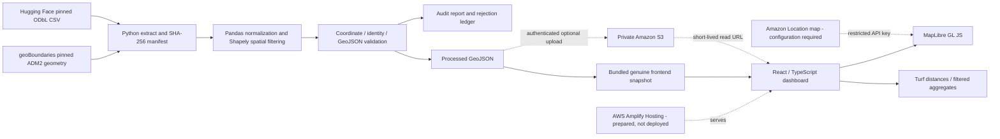

# Architecture

Solid lines are the locally exercised data flow; dotted AWS paths are implemented or prepared but not exercised without credentials.

## Design decisions

The app is a static React application with client-side geographic overlays. At this dataset size no application backend or database is necessary. The pipeline runs independently and exports a validated snapshot; browser interactions never query Overpass. The map component is lazy-loaded, keeping the dashboard bundle separate from the WebGL renderer. Vite explicitly bundles MapLibre’s module worker, including its shared imports.

Amazon Location supplies the actual basemap style, tiles, glyphs and sprites when configured. Rendering uses the previous Maps API resource model to satisfy the requested named map resource and narrowly scoped map key. The documented newer Maps V2 API is a possible future migration, not mixed into the current authentication configuration.

Without a configured map key, MapLibre uses a local background style and genuine GeoJSON overlays. This is explicitly labeled a no-basemap development mode; it does not use another provider. The historical study boundary provides geographic context. The production build never creates random or fabricated location data.

## ETL modules

`extract.py` downloads pinned source files and hashes them; `transform.py` preserves source IDs, normalizes categories, applies polygon filtering and records rejection reasons; `validate.py` checks finite/ranged coordinates and GeoJSON identity/geometry; `export_geojson.py` orchestrates and exports accepted/rejected CSV, report and public GeoJSON; `upload_s3.py` verifies an explicitly selected existing private bucket, checks its owner and public-access blocks, uploads a content-addressed object with a conditional write and generates an ignored short-lived URL file.

Every source row receives one disposition. Rejection reasons have deterministic precedence: coordinates, study area, identifier, exact duplicate. Co-located distinct records are retained rather than conflating multiple facilities in one building. The report describes source completeness, not independently verified accuracy.

## Browser flow

Fetch and validate GeoJSON → derive available categories → combine case-insensitive search and category filters → send filtered data to the clustered and heatmap sources → derive charts from the same filtered features. Cluster numbers are HTML markers so local mode has no external glyph dependency. Selection resolves back to the original typed feature, never injects raw source HTML. Nearby distances use all accepted facilities; filter-aware current-location sorting uses the current view. All distances are straight-line, not routes or travel times.

## Security and delivery

AWS account secrets are never exposed in Vite variables. A restricted Amazon Location public map API key is a browser credential with allowed map ARN, allowed rendering actions, referrers and expiry. S3 remains private. A presigned URL is a temporary bearer token; the upload tool writes it to an ignored file and does not log it. Long-lived public deployments should serve the bundled snapshot or add a properly authenticated delivery endpoint later. No permanent public S3 policy is needed for the implemented local integration.
